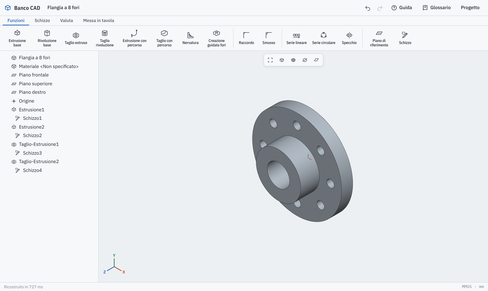
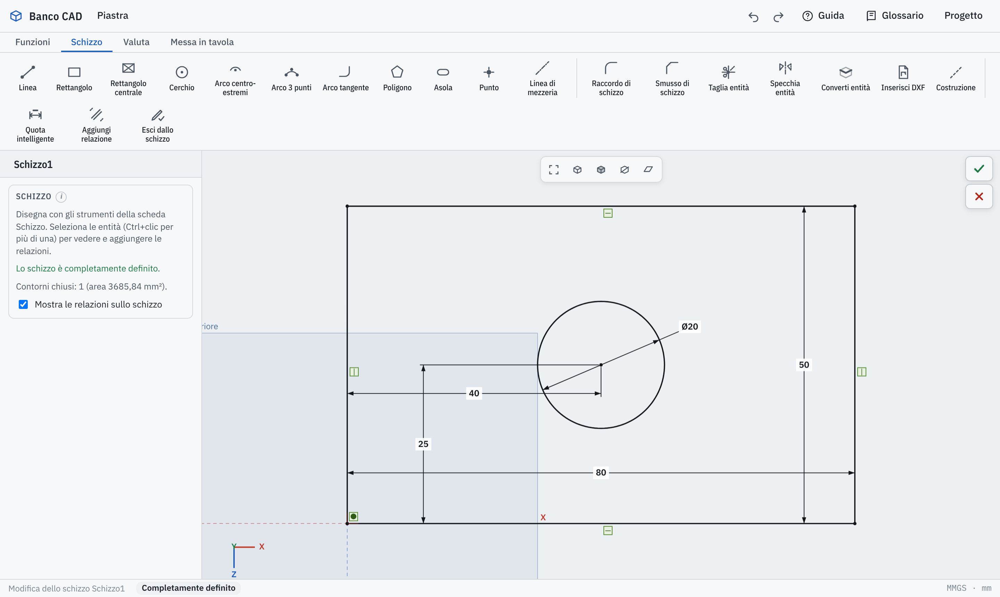
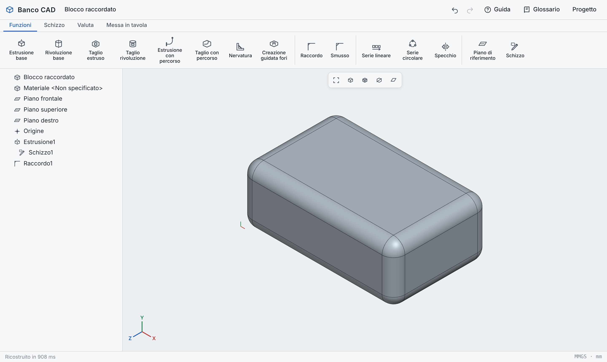
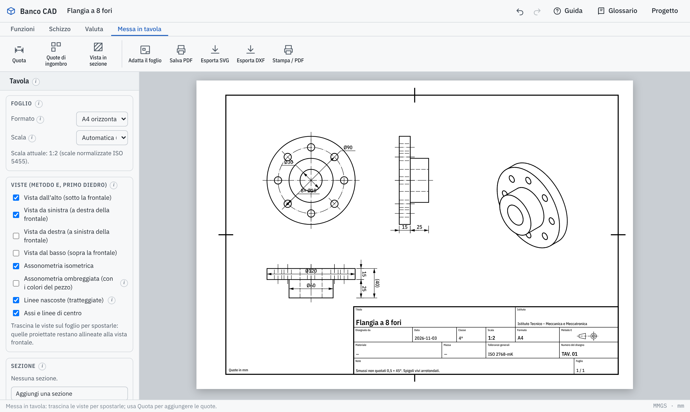
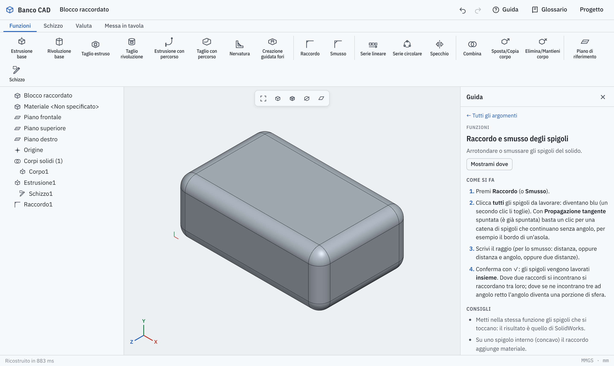
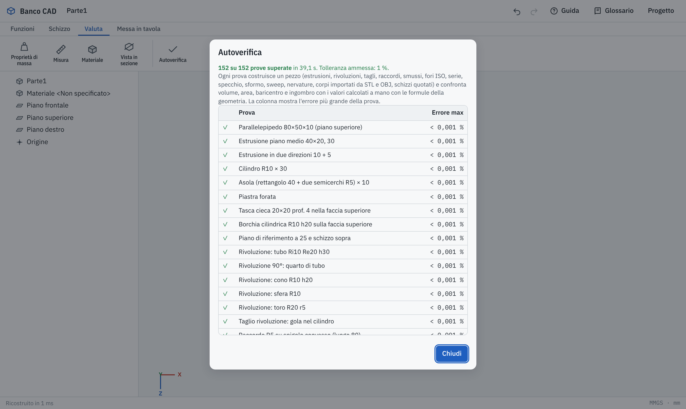

# Banco CAD

[Italiano](README.md) · **English**

A parametric 3D modeler for schools, inspired by SolidWorks, in **a single HTML page**: double-click it to open it in Chrome, Edge or Firefox. There is nothing to install and it works offline.

> The program is in **Italian** and **English**: choose **Project › Language: English** (in Italian: *Progetto › Language: English*), or open [rayuk-creator.github.io/CAD/?lang=en](https://rayuk-creator.github.io/CAD/?lang=en). The commands use the names of the English version of SolidWorks, and the Guide, the Glossary and the [user manual](https://rayuk-creator.github.io/CAD/docs/Manual-Banco-CAD.pdf) are in English too. The pictures on this page show the Italian interface.



Designed for technical secondary schools (mechanical and mechatronic engineering): students learn the workflow of professional CAD (dimensioned sketch, features, feature tree, ISO technical drawings) on a lightweight program that runs on any school computer or tablet.

---

## Contents

1. [Getting started](#getting-started)
2. [Your first part in 6 steps](#your-first-part-in-6-steps)
3. [View controls](#view-controls)
4. [What it can do](#what-it-can-do)
5. [Guide, glossary and manual](#guide-glossary-and-manual)
6. [Verified calculations](#verified-calculations)
7. [For developers](#for-developers)
8. [License](#license)

---

## Getting started

> [!IMPORTANT]
> **How to use Banco CAD**
>
> **The easiest way: open [rayuk-creator.github.io/CAD/?lang=en](https://rayuk-creator.github.io/CAD/?lang=en)** and Banco CAD starts right away in your browser, in English, tablets included. Your work is saved in that browser.
>
> **To use it without internet**, download the file and open it from your computer (here on GitHub the file is stored but does not run). Work done on the website and work done with the downloaded file are kept separate: to move it from one to the other use **Project › Export project** and **Project › Import a project**.
>
> 1. Open the file [`index.html`](index.html).
> 2. GitHub says the file is too big to display ("Sorry about that, but we can't show files that are this big right now"): **this is normal**, the file is fine. Press the **Download raw file** button: the **down arrow** at the top right. Do **not** press "Raw" or "View raw": they would only show the program's text.
> 3. The downloaded file is called `index.html`, **like the DWG → DXF converter**: rename it, for example `banco-cad.html`, so you don't mix them up.
> 4. **Double-click** it: it opens in Chrome, Edge or Firefox. No internet needed. The first time it opens in Italian: choose **Progetto › Language: English** (the choice is remembered in that browser).
> 5. Press **Guide** at the top right and start with “Your first part in 6 steps”.

Your work is saved automatically in the browser. To move it to another computer use **Project › Export project** and then **Project › Import a project**.

With **Project › Export STEP** the part opens in another CAD program (SolidWorks, Inventor, Fusion, FreeCAD…): planes, cylinders, cones, spheres and tori arrive as **true surfaces**, with circular, elliptical or B-spline edges (for example where two cylinders cross), as SolidWorks would write them. **Save PDF** saves the drawing, the sketch or the 3D view.

With **Project › Import STEP or IGES** you can open a part (or a small assembly) made with another CAD program (SolidWorks, Inventor, Fusion, FreeCAD… saved as STEP or IGES): it arrives with its real faces and the file's units; you can measure it, put it on a drawing, get volume and mass with an error well below 1 %, and add sketches and features on it. If the file holds several bodies you choose which ones to import, and each arrives as its own **Imported** feature (or all together in one); face colors written in the file show on the part. The reader is OpenCascade, compressed inside the page: it works offline too, and reads the file in the background so the page never freezes (reading can be canceled).

With **Project › Import STL or OBJ** you can also open a part made with another program (SolidWorks, Inventor, Tinkercad… saved as STL or OBJ): it arrives as a faceted body that you can measure, put on a drawing and weigh, and you can add sketches and features on its flat faces.

With **Project › Import DXF or DWG (sketch)**, or **Insert DXF or DWG** in the Sketch tab, a 2D drawing (AutoCAD, DraftSight, LibreCAD, a SolidWorks drawing…) becomes a sketch: lines, arcs, circles, polylines, ellipses, splines and blocks, in the file's units; ellipses and splines become chains of tangent arcs (biarcs) within a few thousandths of a millimeter of the true curve; dash-dot axes become centerlines. The window shows a preview of the drawing and lets you pick the layers to import (for example without the title block and dimensions). Then you extrude or revolve it.

AutoCAD **DWG** files open directly in the same way, from release R1.4 to 2018 (so also files from AutoCAD 2019–2025), with the free LibreDWG reader inside the page. Texts, dimensions, hatches, geometric tolerances, multileaders and tables can arrive as a **gray background** under the sketch, only to look at while you dimension it: they do not drive the shape and do not end up in the part. Tables in DWG files saved from 2010 onwards stay out (the reader does not give their position): the final message counts them.

To **save DXF files** (for other programs) or convert many drawings at once there is the **DWG → DXF converter** (*Convertitore DWG → DXF*), a separate page (folder `convertitore-dwg/`); Banco CAD also opens the `.zip` in which the converter saves the DXF files. The converter is still in Italian only.

> [!IMPORTANT]
> **How to use the DWG → DXF converter**
>
> **The easiest way: open [rayuk-creator.github.io/CAD/convertitore-dwg](https://rayuk-creator.github.io/CAD/convertitore-dwg/)** and the converter starts right away in your browser.
>
> **To use it without internet**, download the file and open it from your computer (here on GitHub the file is stored but does not run):
>
> 1. Open the file [`convertitore-dwg/index.html`](convertitore-dwg/index.html).
> 2. GitHub says the file is too big to display ("Sorry about that, but we can't show files that are this big right now"): **this is normal**, the file is fine. Press the **Download raw file** button: the **down arrow** at the top right. Do **not** press "Raw" or "View raw": they would only show the program's text.
> 3. The downloaded file is called `index.html`, **like Banco CAD**: rename it, for example `convertitore-dwg.html`, so you don't mix them up.
> 4. **Double-click** it: it opens in Chrome, Edge or Firefox. No internet needed.
> 5. Press **Scegli i file DWG** (*choose DWG files*, or drag the `.dwg` files onto the page), check the **preview**, then press **Salva DXF** (*save DXF*) next to each drawing, or **Salva tutti i DXF (.zip)** (*save all DXF*) to get them in one file.
> 6. If you need it in Banco CAD: **Project › Import DXF or DWG (sketch)** opens the `.dwg` directly, or the `.dxf` you just saved.
>
> It also works on **tablets and phones**: the converter starts with 16 MB of memory and takes more only for large drawings.

## Your first part in 6 steps

Every model follows the same path: **dimensioned sketch → feature**.



1. In the **Sketch** tab click **Top Plane** in the tree, then press **Sketch**.
2. Draw a **Corner Rectangle** starting from the origin (the pointer snaps to it).
3. With **Smart Dimension** click a side, click where to place the dimension and type the value (80, then 50).
4. When the sketch turns **black** it is **Fully Defined**: shape and position are fixed.
5. Press **Extruded Boss/Base** (Features tab): the sketch is confirmed automatically.
6. Type the depth and confirm with ✓.

Sketch colors tell you where you are: **blue** = dimensions or relations still missing, **black** = fully defined, **red** = one dimension or relation too many.

## View controls

| Action | Mouse | Tablet |
|---|---|---|
| Zoom (in and out) | wheel, towards the pointer: forward zooms in, backward zooms out (in drawings too) | two fingers (always) |
| Rotate | Ctrl + wheel, or drag with the left button on empty space | tap the part, then one finger |
| Pan | drag with the right button (or Shift + left) | tap the part, then two fingers |
| Fit the part to the window | **F** key or the first button of the view toolbar | first button of the view toolbar |
| Standard views (Front, Top, Isometric…) | spacebar | orientation button in the view toolbar |

On a tablet, when you tap the part the view gets a blue border and “Part held” appears. Tap empty space or press **Release** to let go.

## What it can do

### Parametric sketch

**Line**, **Corner Rectangle** and **Center Rectangle**, **Circle**, arcs (**Centerpoint Arc**, **3 Point Arc**, **Tangent Arc**), **Polygon**, **Straight Slot**, **Point**, **Centerline** and construction geometry; **Sketch Fillet** and **Sketch Chamfer**, **Trim Entities**, **Mirror Entities** and **Convert Entities**. Geometric relations (coincident, horizontal, vertical, parallel, perpendicular, tangent, equal, concentric, symmetric…) and **Smart Dimension** for lengths, distances, diameters, radii and angles.

### Features



- **Extruded Boss/Base** and **Extruded Cut**: blind, through all, mid-plane, two directions, **draft**.
- **Revolved Boss/Base** and **Revolved Cut** for turned parts.
- **Sweep** and **Swept Cut** along tangent lines and arcs, or along a helix: real springs and threads.
- **Loft** and **Lofted Cut**: a solid that passes through two or more profiles on different planes (twisted blades, hoppers, square-to-round transitions).
- **Helix and Spiral**: the curve for springs, threads and spirals, from a sketch circle.
- **Rib** from an open line, automatically extended to the part.
- **Hole Wizard** to standards: clearance (ISO 273), counterbore (DIN 974-1), countersink (ISO 15065), tapped (tap drill), M3 to M20.
- **Fillet** and **Chamfer** on edges, all processed **together** as in SolidWorks: where two fillets meet they blend, where three meet at a right angle the corner becomes a spherical patch. Arcs (slots) and the edge of an imported ellipse or spline can be filleted too; one click picks the whole curved edge. With **tangent propagation** (as in SolidWorks) one click on an edge also processes the edges that continue it without a corner, for example the whole edge of a slot.
- **Linear Pattern** (also as a grid), **Circular Pattern**, **Mirror**, **Reference Plane**.
- **Solid bodies**: **Merge result** box, **Solid Bodies** folder in the tree, **Combine** (Add, Subtract, Common), **Body-Move/Copy**, **Body-Delete/Keep**, **Feature Scope** with **Auto-select** to choose the bodies of a cut, hole, extrusion, revolve, sweep, rib or imported body; **patterns and mirrors of whole bodies**; mass for each body, one solid per body in STEP.
- FeatureManager design tree with edit, suppress, rollback bar, undo and redo.

### Assembly

- Several parts **in the same project** (and the same file): **New Part**, part list at the top, double-click a component to open its part.
- **Insert Part**: a part of the project, several copies of it, or a STEP, IGES, STL, OBJ file or an exported project. A STEP file with several bodies gives one part per body, at the positions in the file.
- **Mate**: coincident, concentric, parallel, perpendicular, distance, angle, between faces, edges, vertices, and the planes and origin of parts (including cones, spheres and tori from STEP files); a vertex is found again by itself when you change the dimensions; fixed part; degrees of freedom of each component in the tree; a message when two mates contradict each other.
- **Dragging** components within their remaining degrees of freedom, by mouse or finger (**Move Component**). If you edit a part, the assembly is solved again.
- **Several assemblies** in one project and **subassemblies**, also **flexible** ones (their parts move in the upper assembly).
- **Tangent** mate between planes, cylinders and spheres, also on the free-form surfaces of STEP files.
- **Screw in Hole**: one click on a hole inserts the right size and mates it; chamfers, threads in section views, a true helix on request; bill of materials as CSV.
- **Screws and Bolts**: ISO 4762, 10642, 4014 and 4017 screws, ISO 4032 nuts and ISO 7089 washers from M3 to M20, with cosmetic threads drawn as in ISO 6410.
- **Export STEP** of the assembly: one solid per component. **Mass Properties**, **Bill of Materials**, **Interference Detection** (true volume on the exact surfaces), **Exploded View** and **assembly drawing** with balloons (which can be dragged) and parts list.

### Evaluate

**Mass Properties** (volume, area, mass, center of mass, bounding box) computed on the exact surfaces, 13 materials (steels, cast iron, aluminum, brass, copper, plastics), **Measure**, **Section View**.

### Drawing



Orthographic views in **first-angle projection** (ISO 5456-2), hidden lines, centerlines, hatched section views, dimensions (also automatic), title block, A4 to A2 sheets with standard scales. The isometric view can be **shaded**, with the part's colors (including those of a STEP file). **Save PDF** (a vector PDF of the drawing on the real sheet size, at 1:1), print to scale, export to **SVG** and **DXF** (for AutoCAD). The Project menu also saves a PDF of the open sketch (vector, at the largest standard scale that fits an A4 sheet) or of the 3D view, exports the part as **STEP** to open it in SolidWorks, Inventor, Fusion or FreeCAD (a solid in millimeters, with true surfaces: planes, cylinders, cones, spheres and tori) and as **STL** for 3D printing.

## Guide, glossary and manual

**User manual as a PDF, to download and print:** [Manual-Banco-CAD.pdf](https://rayuk-creator.github.io/CAD/docs/Manual-Banco-CAD.pdf) (A4, 63 pages: guided exercise, every command, glossary, with English screenshots). In Italian: [Manuale-Banco-CAD.pdf](https://rayuk-creator.github.io/CAD/docs/Manuale-Banco-CAD.pdf). In the program: **Project › User manual (PDF)**.



- **Guide** (button at the top): 66 “how to” topics with numbered steps, tips and terms. **Show me where** opens the right tab and makes the command blink.
- **Glossary**: 233 terms explained in plain words (commands, relations, options, standards). The small **ⓘ** next to panel headings opens the explanation of that item.

## Verified calculations

Every calculation is checked by automatic tests: more than 120 test parts (extrusions, revolves, cuts, fillets and chamfers including several edges at once, arcs, the edges of ellipses and splines and tangent propagation, ISO holes, patterns, mirror, draft, sweep, ribs, bodies imported from STL, OBJ, STEP and IGES, sketches imported from DXF including ellipses and splines, dimensioned sketches) are rebuilt and their volume, area, center of mass and bounding box are compared with values worked out by hand with geometry formulas. The allowed error is **1 %**; today it is practically zero. Another 51 tests run the real reader on STEP and IGES files written for the purpose (blocks, cylinder, plate with a hole, different units, assemblies with colors, damaged files); 21 of them read back the STEP files exported by Banco CAD: with true surfaces the volume read back is the exact one (sphere, cone, tube, plate with holes).

The same tests can be run inside the program: **Evaluate › Self-check**.



## For developers

The program is one file, `index.html` (about 9 MB), with HTML, CSS and JavaScript together, no build step. The STEP/IGES reader (occt-import-js with OpenCascade, LGPL 2.1 license) and the DWG reader (LibreDWG, GPL 3 license) are compressed at the end of the page, the IBM Plex fonts at the top: licenses and how to replace them are in `licenze/`. The tests use Node.js and Playwright. Code comments and file names are in Italian.

```bash
npm install
npx playwright install chromium   # first time only
npm test                          # all tests
npm run test:kernel               # calculations only (342 + 51 STEP/IGES and exported STEP + 22 DWG reader and converter + 12 language tests, about a minute)
npm run test:ui                   # interface only, in Chromium (100 tests)
npm run test:lingua               # interface sentences without an English translation
```

If you already have Chromium installed you can point to it with `CHROMIUM_PATH=/path/to/chrome npm run test:ui`. When a test fails, screenshots are saved in `tests/output/`.

```
index.html            the complete program
docs/img/             the images in this README
docs/*.pdf            the user manuals (Manuale: Italian, Manual: English)
tests/extract.js      extracts the calculation modules from the file to test them in Node
tests/kernel.test.js  calculation tests (the same as the in-app Self-check)
tests/ui.test.js      interface tests with Playwright
tests/pdfcheck.py     reads the saved PDFs back with pdfplumber (Python) and measures them in mm
tests/step.test.js    tests of the real STEP/IGES reader and of exported STEP files (read back with OpenCascade)
tests/stepgen.js      writes small STEP test files (igesgen.js: IGES)
tests/dwg.test.js     tests of the DWG → DXF converter (DWG from R11 to 2018, compared with reference DXF files)
tests/lingua.test.js  tests of the English translation
tools/traduzione/     English translation: dictionary, Glossary and Guide (incorpora.js puts them into the page)
tools/manuale/        scripts that rebuild the PDF manuals (fai.sh; with en the English one)
tools/incorpora-occt.js  inserts or updates the STEP/IGES reader in the page
LICENSE               GPL 3 license of Banco CAD
licenze/              licenses of parts by other authors, and LEGGIMI (readme)
convertitore-dwg/     DWG → DXF converter, a separate GPL 3 program (LibreDWG): page, LEGGIMI (readme), tests
```

The interface tests use the program the way a student would: they draw with the mouse, type dimensions, press buttons, simulate fingers on a tablet and reload the page. They also check that every command is explained in the Guide and the Glossary, and that every sentence of the interface has its English translation.

## License

Banco CAD, Copyright © 2026 Rayuk-creator. It is free software under the [GNU GPL 3](LICENSE) (or later versions), with the [additional terms](CONDIZIONI-AGGIUNTIVE.md) of section 7 (keep the notice, mark modified versions, the “Banco CAD” name), and **no warranty**. Parts by other authors (STEP/IGES and DWG readers, csg.js, Adobe metrics, IBM Plex fonts) are listed in [`licenze/LEGGIMI.md`](licenze/LEGGIMI.md) and inside the program, under **Project › About and licenses**.

The program **collects no data**: everything stays in the browser, and not even the fonts are downloaded from other sites.

SolidWorks is a trademark of Dassault Systèmes, AutoCAD of Autodesk; Banco CAD is not affiliated with them.

Written with the help of Claude.
