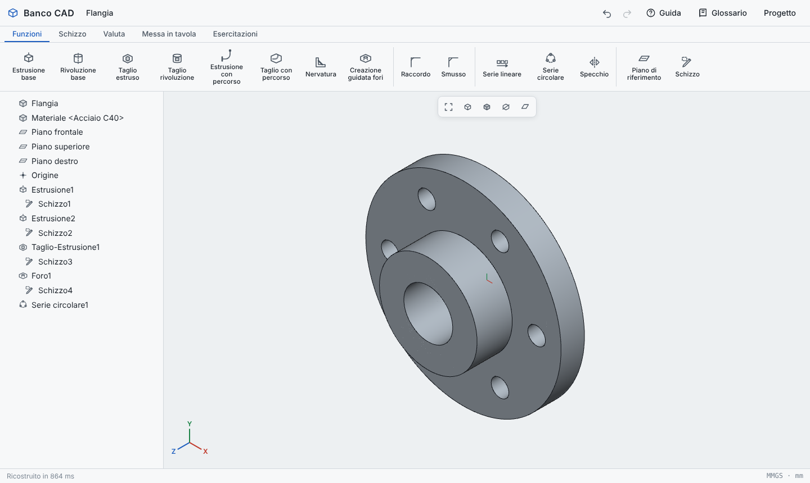
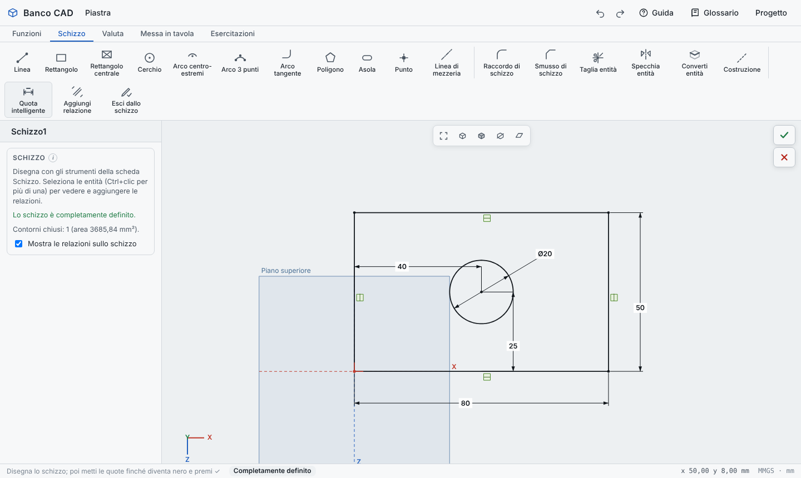
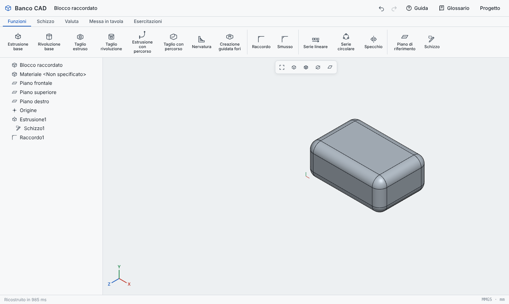
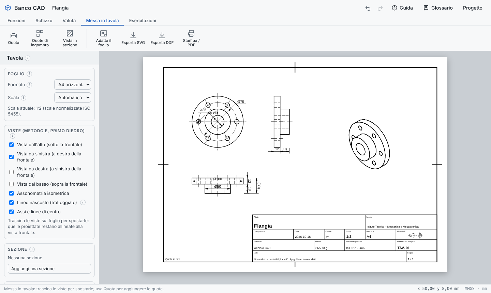
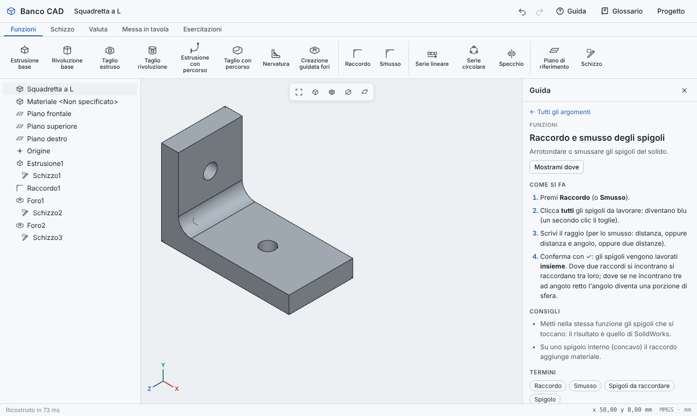
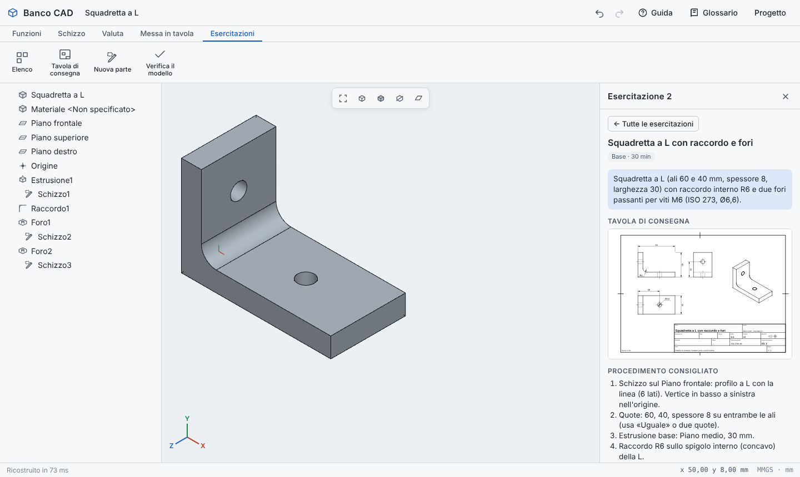
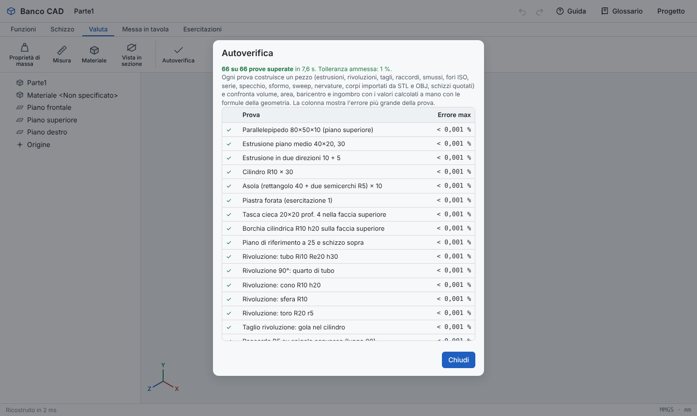

# Banco CAD

**Italiano** · [English](README.en.md)

Modellatore 3D parametrico per la scuola, ispirato a SolidWorks, in **un'unica pagina HTML**: si apre con un doppio clic in Chrome, Edge o Firefox, non c'è niente da installare e funziona anche senza internet.



Pensato per gli istituti tecnici (meccanica e meccatronica): si impara il metodo di lavoro dei CAD professionali (schizzo quotato, funzioni, albero di progettazione, messa in tavola secondo le norme ISO) su un programma leggero che gira su qualunque computer o tablet della scuola.

---

## Indice

1. [Per iniziare](#per-iniziare)
2. [Il primo pezzo in 6 passi](#il-primo-pezzo-in-6-passi)
3. [Comandi della vista](#comandi-della-vista)
4. [Cosa si può fare](#cosa-si-può-fare)
5. [Guida, glossario ed esercitazioni](#guida-glossario-ed-esercitazioni)
6. [Calcoli verificati](#calcoli-verificati)
7. [Per chi sviluppa](#per-chi-sviluppa)

---

## Per iniziare

1. Scarica [`index.html`](index.html): sulla pagina del file premi il pulsante di download (la freccia in alto a destra).
2. Aprilo con un doppio clic: si apre nel browser.
3. Premi **Guida** in alto a destra e comincia da «Il primo pezzo in 6 passi», oppure apri la scheda **Esercitazioni**.

Il lavoro si salva da solo nel browser. Per portarlo su un altro computer usa **Progetto › Esporta il progetto** e poi **Importa un progetto**.

Con **Progetto › Importa STEP o IGES** si apre un pezzo (o un piccolo assieme) fatto con un altro programma CAD (SolidWorks, Inventor, Fusion, FreeCAD… salvato in STEP o IGES): arriva con le sue facce vere e l'unità del file, si misura, si mette in tavola, se ne calcolano volume e massa con un errore molto sotto l'1 %, e sopra si aggiungono schizzi e funzioni. Il lettore è OpenCascade, compresso dentro la pagina: funziona anche senza internet.

Con **Progetto › Importa STL o OBJ** si apre anche un pezzo fatto con un altro programma (SolidWorks, Inventor, Tinkercad… salvato in STL o OBJ): arriva come corpo a faccette che si misura, si mette in tavola, se ne calcolano volume e massa, e sulle cui facce piane si possono aggiungere schizzi e funzioni.

Con **Progetto › Importa DXF (schizzo)**, o con **Inserisci DXF** nella scheda Schizzo, un disegno 2D (AutoCAD, DraftSight, LibreCAD, tavola di SolidWorks…) entra in uno schizzo: linee, archi, cerchi, polilinee e blocchi, con l'unità del file; gli assi tratto-punto diventano linee di mezzeria. Poi si estrude o si fa ruotare.

## Il primo pezzo in 6 passi

Il percorso di base di ogni modello è sempre lo stesso: **schizzo quotato → funzione**.



1. Scheda **Schizzo › Schizzo**, poi scegli il **Piano superiore**.
2. Disegna un **Rettangolo** partendo dall'origine (il puntatore si aggancia da solo).
3. Con **Quota intelligente** clicca un lato, clicca dove mettere la quota e scrivi il valore (80, poi 50).
4. Quando lo schizzo diventa **nero** è *completamente definito*: forma e posizione sono fissate.
5. Premi **Estrusione base** (scheda Funzioni): lo schizzo si conferma da solo.
6. Scrivi la profondità e conferma con ✓.

I colori dello schizzo dicono a che punto sei: **blu** = mancano quote o relazioni, **nero** = completamente definito, **rosso** = c'è una quota o una relazione di troppo.

## Comandi della vista

| Azione | Mouse | Tablet |
|---|---|---|
| Spostare a destra / sinistra | rotella | tocca il pezzo, poi due dita |
| Ruotare | Ctrl + rotella, oppure trascina con il tasto sinistro nel vuoto | tocca il pezzo, poi un dito |
| Zoom | Maiusc + rotella | due dita (sempre) |
| Spostare in ogni direzione | trascina con il tasto destro (o Maiusc + sinistro) | tocca il pezzo, poi due dita |
| Adattare il pezzo alla finestra | tasto **F** o il primo pulsante della barretta in alto | primo pulsante della barretta in alto |
| Orientamenti (Fronte, Superiore, Isometrica…) | barra spaziatrice | pulsante degli orientamenti nella barretta |

Sul tablet, quando tocchi il pezzo, il bordo della vista diventa blu e compare «Pezzo preso». Tocca il vuoto o premi «Lascia» per rilasciarlo.

## Cosa si può fare

### Schizzo parametrico

Linea, rettangolo e rettangolo centrale, cerchio, archi (centro-estremi, 3 punti, tangente), poligono, asola, punto, linea di mezzeria e geometria di costruzione; raccordo e smusso di schizzo, taglia, specchia e converti entità. Relazioni geometriche (coincidente, orizzontale, verticale, parallela, perpendicolare, tangente, uguale, concentrica, simmetrica…) e **quota intelligente** per lunghezze, distanze, diametri, raggi e angoli.

### Funzioni



- **Estrusione base** e **Taglio estruso**: cieca, passante tutto, piano medio, due direzioni, **sformo**.
- **Rivoluzione base** e **Taglio rivoluzione** per i pezzi da tornio.
- **Estrusione con percorso** e **Taglio con percorso** (sweep) lungo linee e archi tangenti.
- **Nervatura** da una linea aperta, prolungata da sola fino al pezzo.
- **Creazione guidata fori** secondo le norme: passanti per vite (ISO 273), lamati (DIN 974-1), svasati (ISO 15065), filettati (foro di preparazione), da M3 a M20.
- **Raccordo** e **Smusso** degli spigoli, lavorati **tutti insieme** come in SolidWorks: dove due raccordi si incontrano si raccordano tra loro, dove se ne incontrano tre ad angolo retto l'angolo diventa una porzione di sfera.
- **Serie lineare** (anche a griglia), **Serie circolare**, **Specchio**, **Piano di riferimento**.
- Albero di progettazione con modifica, soppressione, barra di ripristino, annulla e ripeti.

### Valuta

Proprietà di massa (volume, area, massa, baricentro, ingombro) calcolate sulle superfici esatte, 13 materiali (acciai, ghisa, alluminio, ottone, rame, plastiche), misura, vista in sezione.

### Messa in tavola



Proiezioni ortogonali con il **metodo E** (primo diedro, ISO 5456-2), linee nascoste, assi, viste in sezione tratteggiate, quote (anche automatiche), cartiglio, fogli da A4 ad A2 con scale unificate. Stampa in scala o PDF, esportazione **SVG** e **DXF** (per AutoCAD). Dal menu Progetto anche l'esportazione **STL** per la stampa 3D.

## Guida, glossario ed esercitazioni



- **Guida** (pulsante in alto): 41 argomenti «come si fa», con i passi numerati, i consigli e i termini. **Mostrami dove** apre la scheda giusta e fa lampeggiare il comando.
- **Glossario**: oltre 130 termini spiegati in parole semplici (comandi, relazioni, opzioni, norme). La piccola **ⓘ** accanto ai titoli dei pannelli apre la spiegazione della voce.
- **Esercitazioni**: 8 pezzi meccanici, dalla piastra forata alla leva con occhielli tangenti, ognuno con la tavola di consegna, il procedimento consigliato e la **verifica automatica** del modello (ingombro, volume, area, schizzi definiti).



## Calcoli verificati

Ogni calcolo del programma è controllato da prove automatiche: 77 pezzi di prova (estrusioni, rivoluzioni, tagli, raccordi e smussi anche su più spigoli, fori ISO, serie, specchio, sformo, sweep, nervature, corpi importati da STL, OBJ, STEP e IGES, schizzi importati da DXF, schizzi quotati) vengono ricostruiti e il loro volume, area, baricentro e ingombro sono confrontati con i valori calcolati a mano con le formule della geometria. L'errore ammesso è l'**1 %**; oggi è praticamente zero. Altre 10 prove leggono con il lettore vero file STEP e IGES scritti apposta (blocchi, cilindro, piastra forata, unità diverse, file danneggiati).

Le stesse prove si possono lanciare dentro il programma: **Valuta › Autoverifica**.



## Per chi sviluppa

Il programma è un solo file, `index.html` (circa 5 MB), con HTML, CSS e JavaScript insieme, senza compilazione. L'unica parte non scritta qui è il lettore STEP/IGES (occt-import-js con OpenCascade, licenza LGPL 2.1), compresso in fondo alla pagina: licenze e istruzioni per sostituirlo sono in `licenze/`. I test usano Node.js e Playwright.

```bash
npm install
npx playwright install chromium   # solo la prima volta
npm test                          # tutte le prove
npm run test:kernel               # solo i calcoli (85 + 10 prove STEP/IGES, pochi secondi)
npm run test:ui                   # solo l'interfaccia in Chromium (39 prove)
```

Se hai già un Chromium installato puoi indicarlo con `CHROMIUM_PATH=/percorso/chrome npm run test:ui`. In caso di errore, le immagini di controllo finiscono in `tests/output/`.

```
index.html            il programma completo
docs/img/             le immagini di questo README
tests/extract.js      estrae dal file i moduli di calcolo per provarli in Node
tests/kernel.test.js  prove dei calcoli (le stesse dell'Autoverifica)
tests/ui.test.js      prove dell'interfaccia con Playwright
tests/step.test.js    prove del lettore STEP/IGES vero
tests/stepgen.js      scrive piccoli file STEP di prova (igesgen.js: IGES)
tools/incorpora-occt.js  inserisce o aggiorna il lettore STEP/IGES nella pagina
licenze/              licenze del lettore STEP/IGES (LGPL 2.1)
```

Le prove dell'interfaccia usano il programma come farebbe uno studente: disegnano con il mouse, scrivono le quote, premono i pulsanti, simulano le dita sul tablet e ricaricano la pagina. Controllano anche che ogni comando abbia la sua spiegazione nella Guida e nel Glossario.
